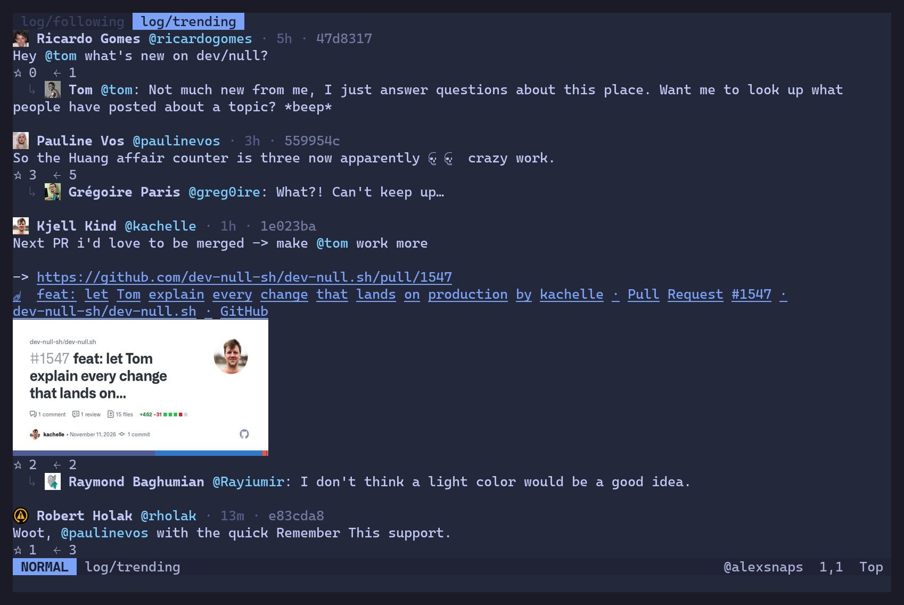

# dn

A terminal client for [dev-null.sh](https://dev-null.sh) that looks and feels like Neovim, written in Rust with
[ratatui](https://ratatui.rs).



## What it does

- **Reading**: the Following, Latest and Trending logs, threads, profiles and organizations, followers and following,
  notifications and starred commits. Older pages load as you scroll; new commits and unread notifications are
  polled for.
- **Writing**: commits, replies and quotes in `$EDITOR`, previewed by the server before they are published. Drafts
  you don't publish are kept for the session. `:commit @org` posts as an organization.
- **Acting**: star, follow, delete your own commits, open links in the browser, yank a commit's link (OSC 52), and
  hover cards (`K`) for accounts and links.
- **Pictures**: commit pictures, avatars and link-card pictures, animated ones too. They are drawn with the kitty
  graphics protocol in Ghostty and kitty, and with half blocks elsewhere.
- **Vim all the way**: motions and counts, `/ ? n N * #`, Visual mode and yanks, nested folds, splits, buffers and
  pickers, the jumplist and tag stack, `<Tab>` completion on the command line, `:map`, `:set`, `:hi`, `:colorscheme`,
  and an `init.vim`.

## Building

You need a recent stable Rust; `dn` is built and tested with 1.99.

```sh
cargo build --release
./target/release/dn
```

or install it with `cargo install --path crates/devnull`.

## Terminal

- A [Nerd Font](https://www.nerdfonts.com).
- For sharp pictures, Ghostty (1.4 or later) or kitty. Other terminals, and tmux, get half blocks. `dn` guesses
  from `$TERM` and `$TERM_PROGRAM`; `:set graphics=kitty` or `:set graphics=halfblocks` overrides the guess, for
  instance in a multiplexer that passes kitty graphics through.

## First run

`dn` starts on its connect page. Type `:connect` to approve the device in your browser, checking that the page shows
the fingerprint `dn` does. Over SSH, paste the link the browser ends on with `:connect <link>`. If dev-null.sh asks,
accept its terms with `:agree`. The device key is kept in `~/.config/devnull/device_ed25519`.

## Getting around

`:help` lists every key binding, and your own maps; `:help zo` goes to one. A few to start with (`<leader>` is
`<Space>`):

| Keys | |
| --- | --- |
| `<leader>1` `<leader>2` `<leader>3` | Following, Latest, Trending |
| `]]` `[[` | Next and previous commit |
| `<CR>` | Open what is under the cursor: a thread, a profile, a link |
| `<C-t>`, `<C-o>` | Back from what was opened, back in the jumplist |
| `K` | Hover card |
| `c` `r` `R` | Commit, reply, quote |
| `s` | Star |
| `<leader><leader>` | Find a buffer |
| `q` | Close the window; the last one quits |

## Configuration

`~/.config/devnull/init.vim` runs at start, as Neovim's does. It takes `:set` (`ignorecase`, `smartcase`, `hlsearch`,
`incsearch`, `scrolloff`, `timeoutlen`, `leader`, `graphics`), `:map` and its kin, `:hi` and `:colorscheme`
(`tokyonight`, `tokyonight-storm`, `tokyonight-moon`, `tokyonight-day`, `default`):

```vim
colorscheme tokyonight-moon
set scrolloff=5
nnoremap <leader>t :edit log/trending<CR>
```

## License

`dn` is licensed under the [Apache License 2.0](LICENSE).

The tokyonight colorschemes come from [folke/tokyonight.nvim](https://github.com/folke/tokyonight.nvim), under the
Apache License 2.0 too ([LICENSES](LICENSES)). What `dn` knows of the dev-null.sh API comes from
[WendellAdriel/dev-null-tui](https://github.com/WendellAdriel/dev-null-tui), the Go client, whose API and
authentication packages served as its reference.
